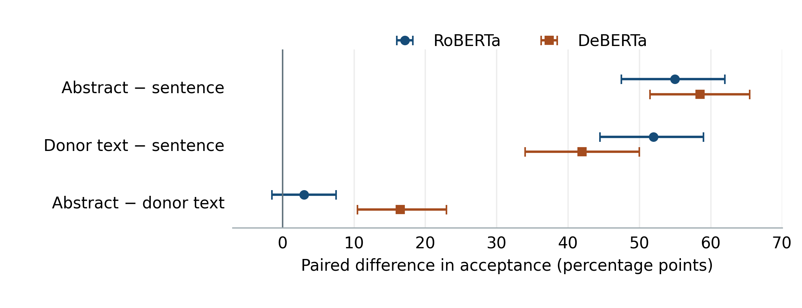

# Surrounding text raises MiniCheck acceptance of overstated scientific claims

Yunjie Guo and Hanqing Yang  
Independent Researcher, Suzhou, China  
Correspondence to Hanqing Yang, hanqing.yang189@gmail.com

## Abstract

A paper may report that an effect is possible while its citation states that the effect will occur. We tested two MiniCheck encoders on 200 such modal edits that a human judged unsupported even by the full abstract. With the edited claim held fixed, replacing the qualified source sentence with the abstract increased acceptance from 36.5% to 91.5% for RoBERTa and from 29.0% to 87.5% for DeBERTa. In a subsequent descriptive control, we surrounded the same sentence with words from other abstracts, matching the original word count and sentence position. Acceptance rose to 88.5% and 71.0%, respectively. The original abstract therefore yielded a further 3.0 percentage points for RoBERTa (paired 95% interval, −1.5 to 7.5) and 16.5 for DeBERTa (10.5 to 23.0). The increases with donor text also appeared when every input fit in a single model chunk. In a separate confirmatory comparison, an explicit instruction to check evidential strength reduced modal acceptance by 24.0 points for DeepSeek and 61.5 for Qwen, with observed acceptance losses below one point on copied and weakened controls. These results distinguish sensitivity to surrounding text from the additional contribution of the original context on a single-reader, rule-edited scientific benchmark.

## Introduction

A paper may report that a treatment *may* improve an outcome. Replacing *may* with *will* preserves the entities and direction of the effect, but commits the author to a stronger conclusion. A citation checker that rewards close wording can therefore accept a claim that its source only entertains as a possibility. For a scientific reader the relevant question is whether the cited evidence warrants the claim at its stated strength.

Wuehrl et al. (2024) document changes in certainty, causality and generality as scientific findings enter public reporting. Nnamdi et al. (2026) manipulate hedge removal and prompt a judge to detect directional changes in certainty. Their experiments establish that both the manipulation and the use of an explicit certainty instruction have precedents. Ramprasad and Wallace (2025) show that factuality metrics can also respond to benign edits. A score decrease after rewriting consequently has several possible interpretations. Mujahid et al. (2026) show that the retrieval context can change the stability of factuality judgments on long documents.

Earlier work on evidence granularity shows that splitting documents and aggregating sentence-level entailment scores changes the accuracy of summary evaluation (Laban et al., 2022; Glover et al., 2022). That finding leaves a different question open. When the evidence already contains the qualified source sentence, does a verifier need the rest of the *original* abstract to accept an overstatement, or would surrounding prose from another paper produce a similar decision?

We study a binary decision for a fixed claim. The verifier first receives the qualified source sentence as evidence and then, in a separate call, the entire abstract containing that sentence. The abstract may contain evidence elsewhere that genuinely licenses a stronger claim. We therefore estimate the change in false acceptance only among claims that the annotator judged unsupported by the full abstract. A second comparison holds the abstract fixed and changes the instruction given to an API judge. Copied and weakened claims measure how often a stricter instruction also rejects claims it should accept.

## Methods

### Documents and annotation

We used the 5,183 abstracts in the SciFact corpus (Wadden et al., 2020). Two development pilots of 300 papers each shared 261 papers. All 339 distinct pilot papers were excluded, leaving 4,844 candidate documents. Fixed rules identified eligible source sentences of 8–60 words. Within each edit category, a seeded SHA-256 ordering of document and sentence identifiers selected at most one sentence per document. Documents were reserved in the order scope, lexical hedge, causal language, quantifier and modal verb, giving disjoint queues. Later categories thus represent the documents left eligible after earlier reservations. The finite sample supports comparisons within these rule-defined categories.

Modal edits replaced *may* or *might* with *will*. Lexical hedge edits removed or strengthened expressions of uncertainty. An annotator assessed grammatical integrity, whether the claim became stronger, and whether the *full abstract* supported the edited claim. A focal edit qualified when it was well formed or had a minor imperfection, was stronger, and lacked support in the abstract. Scope edits additionally required a generic reading. The annotator traversed each queue in order until reaching the target of 200 valid modal or 150 valid hedge edits, or exhausting the queue. The other three queues were reviewed in full.

One annotator individually reviewed all 899 records in two returns of 833 and 66. The annotator reported tool assistance for the initial return. The workbook showed the source, edit and abstract. The annotator reported being unaware of the hypotheses throughout annotation and having seen no confirmatory model scores. We froze the returned labels before model scoring. Sixty weakening and 60 negation edits were separately audited by human review. The automatic negative-control gate used every available negative edit on the focal roster, including edits outside the hand-audited subset. A negative control was intended to lack evidential support. With a modal premise, a negated forecast can still be logically possible.

### Verifiers and decisions

We ran the upstream RoBERTa-large and DeBERTa-v3-large MiniCheck encoders (Tang et al., 2024). Each received the same claim with either the source sentence or its full abstract. We used the upstream chunking and aggregation, with support defined by a score strictly above 0.5. Inputs for which tokenization indicated clipping were logged and the affected call marked missing. Both pinned checkpoints were checked on the same 50 sentence and 50 abstract pilot inputs immediately before the experiment. All 100 verdicts per checkpoint agreed with the recorded reference implementation.

The two API judges were DeepSeek-V4-Pro and the 8 June 2026 snapshot of Qwen3.7-Max. Each received the full abstract and the same binary support question under two instructions. The generic prompt asked whether the evidence supported the claim. The strength-aware prompt additionally specified certainty, causation, scope and the direction of change. We disabled reasoning, set temperature to zero and limited output to one token. We normalized the top-token Yes/No probability mass where available and used the parsed answer as fallback. Acceptance required a Yes probability of at least 0.5. We repeated calls for a deterministic subsample of 78 of the 779 documents. Repeats measure within-configuration reproducibility and do not increase the primary sample size.

### Statistical analysis

The internally frozen protocol specified six directional tests. **H1** required the full-abstract acceptance rate for human-judged unsupported edits to exceed 70% separately in the modal and lexical hedge groups, for each encoder. **H2** required full-abstract acceptance to exceed sentence-only acceptance by more than 20 percentage points on valid modal edits, for each encoder. **H3** required the strength instruction to reduce acceptance of those modal edits by more than 10 points, for each API judge. H3 also required the observed acceptance losses on identity and weakening controls each to be at most five points. Identity preservation was assessed across all valid documents, and weakening preservation across valid documents with an available matched weakening.

We used a one-sided level of 0.05/6 for each hypothesis. H1 used exact binomial lower bounds. For paired contrasts we recorded changes in both directions and divided their net count by the number of complete pairs, including unchanged decisions. We resampled documents with 10,000 multinomial draws over the three observed differences, using seed 20261124. A constant difference used simultaneous exact bounds on gains and losses. These paired percentile bounds are approximate. Each relevant configuration also had to accept at least 90% of copied claims in the negative-control population, show a paired identity-minus-negation drop of at least 70 points, have at least 150 complete control pairs, and have at most 2% missing planned primary calls. A failed control gate limits interpretation even when an observed endpoint exceeds its threshold.

### Matched donor-text comparison

The protocol proposed an additional evidence condition to interpret the context effect. It was run after the six primary outcomes were known. Before scoring the added condition, we fixed the contrasts and diagnostics in a dated repository commit. We kept each of the 200 modal claims and its qualified source sentence. For each, we preserved the total number of whitespace-delimited words in the abstract and the number preceding the source sentence. The surrounding words came from other SciFact abstracts selected by a document-specific hash. The 3,934-document donor pool excluded both pilots and all reserved documents. We retained the fixed passage even if a donor sentence ended mid-thought. One matched passage per source was scored by each encoder through the same upstream API.

All three presentations were compared on complete document triples. Descriptive 95% intervals used paired document resampling (10,000 draws). We examined the subset where *all three* presentations were scored as one chunk and evaluated the real-minus-donor contrast at fixed score thresholds from 0.1 through 0.9. After inspecting the donor results, we also estimated the between-encoder difference in that contrast, retaining the four decisions for a document together in each bootstrap draw.

## Confirmatory sample

The two primary strata reached their stopping targets at the 216th modal and 203rd hedge document. For modal edits the reader judged 3 strengthened claims supported and 13 unclear. For hedge edits, 15 were supported, 34 unclear and 4 broken. The two queues yielded 350 human-judged unsupported claims. These exclusions show why an altered sentence cannot be assumed to be a false claim about its full abstract.

**Table 1. Document flow from the frozen queues.**

| Focal edit | Reserved | Reviewed | Well formed or minor | Eligible |
|---|---:|---:|---:|---:|
| Modal strengthening | 330 | 216 | 216 | 200 |
| Lexical hedge edit | 220 | 203 | 199 | 150 |
| Scope removal | 150 | 150 | 147 | 137 |
| Causal upgrade | 150 | 150 | 145 | 145 |
| Quantifier inflation | 60 | 60 | 58 | 58 |
| Total | 910 | 779 | 765 | 690 |

Separately, 59/60 audited weakenings and 58/60 audited negations performed the intended change. These control audits can share a source with a focal item. They add 120 annotation records to the 779 focal records.

## Primary decisions

Both encoders crossed the prespecified 70% acceptance threshold in both classes. With only the sentence, RoBERTa accepted 73/200 modal claims and DeBERTa 58/200. Giving each encoder the full abstract raised those counts to 183 and 175 (Tables 2–3).

**Table 2. Full-abstract acceptance of unsupported claims (H1).**

| Encoder | Modal accepted / n | Lower bound, % | Hedge accepted / n | Lower bound, % | H1 |
| --- | --- | --- | --- | --- | --- |
| RoBERTa | 183/200 | 85.6 | 149/150 | 95.5 | Met |
| DeBERTa | 175/200 | 80.9 | 144/150 | 90.4 | Met |

**Table 3. Paired changes in acceptance of modal edits (H2 and H3).**

| Contrast | Pairs | Gains | Losses | Net, pp | Lower, pp | Decision |
| --- | --- | --- | --- | --- | --- | --- |
| RoBERTa H2 | 200 | 112 | 2 | 55.0 | 46.0 | Met |
| DeBERTa H2 | 200 | 117 | 0 | 58.5 | 50.0 | Met |
| DeepSeek H3 | 200 | 48 | 0 | 24.0 | 17.0 | Met |
| Qwen H3 | 200 | 123 | 0 | 61.5 | 53.0 | Met |

For H2, a gain is a switch from rejection with the sentence to acceptance with the abstract. For H3, a gain is a switch from acceptance under the generic prompt to rejection under the strength prompt. Losses are the reverse switches. Lower bounds are one-sided at 1 − 0.05/6. Net effects and their bounds are in percentage points (pp).

The generic and strength prompts accepted 154/200 and 106/200 modal edits for DeepSeek, and 138/200 and 15/200 for Qwen. Across the 690 valid documents, DeepSeek switched two copied claims from acceptance to rejection. It also switched three of 424 matched weakenings. Qwen made no switches on either preservation endpoint (Table 4). All six model-specific hypotheses met their prespecified decision rules.

**Table 4. Acceptance costs of the strength instruction (H3 controls).**

| Judge | Control | Pairs | Generic only | Strength only | Net cost, pp |
| --- | --- | --- | --- | --- | --- |
| DeepSeek | identity | 690 | 2 | 0 | 0.3 |
| DeepSeek | weaken | 424 | 3 | 0 | 0.7 |
| Qwen | identity | 690 | 0 | 0 | 0.0 |
| Qwen | weaken | 424 | 0 | 0 | 0.0 |

## Replacing the rest of the abstract

All 400 donor-text calls produced scores without clipping. The 200 passages used 285 distinct donor documents. RoBERTa accepted 73/200 claims with the sentence alone, 177/200 with donor text, and 183/200 with the original abstract. DeBERTa accepted 58/200, 142/200 and 175/200 in the same conditions. Replacing the donor words with the original surrounding words moved RoBERTa from rejection to acceptance on 13 documents and in the opposite direction on seven. DeBERTa made those switches on 40 and seven documents. Its real-minus-donor contrast exceeded RoBERTa’s by 13.5 points (post hoc paired 95% interval, 6.5 to 20.5).

**Figure 1. Changes in acceptance with the claim and qualified sentence held fixed.** Points are net differences in binary decisions on the same 200 documents. Bars are descriptive 95% paired intervals. “Donor text” includes the original qualified sentence at its original word offset. The abstract-minus-donor interval for RoBERTa spans zero and allows a modest contribution from the original context.

The rise with donor text remained when the scorer had exactly one chunk in every presentation. On those documents, the donor-minus-sentence difference was 54.2 points for RoBERTa (144 documents, 95% interval 45.1 to 62.5) and 43.5 points for DeBERTa (170 documents, 35.3 to 52.4). Word matching left median absolute differences of 26 and 21.5 model tokens between donor and original presentations. The residual contrast also depended on the decision threshold. At 0.7 it was 13.5 points for RoBERTa and 23.5 for DeBERTa, compared with 3.0 and 16.5 at the official 0.5 cutoff. The supplementary aggregate reports all nine thresholds.

## Control performance and repeatability

Every configuration passed its control and missingness gate. Three RoBERTa abstract calls were flagged for input clipping. All 10,216 API calls supplied usable first-token probabilities. Table 5 reports the 2,320 first calls and 234 repeats per configuration separately.

**Table 5. Configuration checks on the confirmatory roster.**

| Configuration | Copies accepted | Negation pairs | Drop, pp | Gains / losses | Missing / planned | Repeat agreement |
| --- | --- | --- | --- | --- | --- | --- |
| RoBERTa / abstract | 424/427 | 427 | 99.1 | 423 / 0 | 3 / 2320 | 234 / 234 |
| RoBERTa / sentence | 427/427 | 427 | 100.0 | 427 / 0 | 0 / 2320 | 234 / 234 |
| DeBERTa / abstract | 426/427 | 427 | 95.6 | 408 / 0 | 0 / 2320 | 234 / 234 |
| DeBERTa / sentence | 418/427 | 427 | 97.7 | 417 / 0 | 0 / 2320 | 234 / 234 |
| DeepSeek / generic | 427/427 | 427 | 100.0 | 427 / 0 | 0 / 2320 | 233 / 234 |
| DeepSeek / strength | 425/427 | 427 | 99.5 | 425 / 0 | 0 / 2320 | 232 / 234 |
| Qwen / generic | 427/427 | 427 | 99.8 | 426 / 0 | 0 / 2320 | 232 / 234 |
| Qwen / strength | 427/427 | 427 | 99.8 | 426 / 0 | 0 / 2320 | 233 / 234 |

Copy acceptance and the identity-minus-negation drop use documents with an available negative edit. The paired drop counts copies accepted and negations rejected as gains. The missingness denominator excludes repeats. Repeat agreement uses jointly observed first and repeat decisions.

## Sensitivity and descriptive results

Removing nine modal edits marked as minor imperfections left 191 documents. The paired context increases were 56.5 points for RoBERTa and 59.2 for DeBERTa. The prompt reductions were 23.6 points for DeepSeek and 61.3 for Qwen. No returned edit received a contested strength judgment, so adding that category would leave eligibility unchanged.

Among 124 valid modal documents with a matched weakening, the acceptance advantage of weakened over strengthened claims was 8.9 points for abstract-level RoBERTa (descriptive 95% interval, 4.0 to 14.5) and 12.1 points for DeBERTa (6.5 to 17.7). For Qwen the same difference grew from 27.4 points under the generic instruction to 88.7 under the strength instruction. These matched comparisons condition on the availability of a weakening edit.

The pattern depended on the edit. In full abstracts, RoBERTa accepted 137/137 scope removals and 138/144 causal upgrades, but 0/58 quantifier inflations. DeBERTa accepted 135/137, 142/145 and 6/58, respectively. Under the strength instruction, DeepSeek accepted 137/137 scope removals and 28/145 causal upgrades. Qwen accepted 129/137 and 5/145. Both rejected all 58 quantifier inflations. The accompanying aggregate data include two-sided exact 95% intervals for these descriptive rates.

## Discussion

A checker can reliably distinguish a copied sentence from a negation while accepting a stronger statement about the same result. With RoBERTa, 112 modal claims changed from rejected to accepted when the evidence expanded to the full abstract; only two changed in the opposite direction. DeBERTa had 117 gains and no losses. The human warrant check matters here. A reader judged that none of these 200 modal edits was supported even after seeing the additional evidence. That judgment defines the error being measured.

Other papers supplied enough surrounding text to reproduce much of the original increase at the official threshold. On single-chunk documents there was no choice among chunks, yet donor text still raised acceptance substantially. DeBERTa also distinguished the two long presentations on more documents than RoBERTa in net terms. Word count and source position alone cannot explain that residual difference between presentations. Its possible causes include topic, coherence, tokenization, and the abrupt boundaries introduced by stitching donor words around the source. A donor passage could also happen to contain relevant evidence. Only the original abstracts received human warrant judgments. Multiple independently drawn donors and token-matched coherent passages would be needed to generalize beyond this construction.

The instruction effect also has a practical limit. DeepSeek still accepted 106/200 unsupported modal edits under the strength prompt, compared with 15/200 for Qwen. Both judges continued to accept most generic scope edits. A reduction in modal errors on this benchmark therefore gives little assurance about the handling of every form of generalization. The small acceptance costs on copied and weakened claims are observed costs on these specific controls. Broader noninferiority across legitimate scientific paraphrases remains open.

One annotator determined whether an edit preserved the underlying claim and exceeded the evidence. Tool assistance was used for at least the first annotation return. There is no independent estimate of rater agreement, and a systematic reading of borderline cases could affect both models in the same direction. A deletion sensitivity calculation indicates the scale of selective mislabeling needed to erase the primary context effect. Even if every removed document were a gain, 88 of 200 modal documents for RoBERTa or 97 for DeBERTa would have to be removed to bring the observed net increase down to the 20-point margin. This bounds the point estimate under selective exclusion. Independent annotation would be needed to measure label error. In particular, changing *may* to *will* can change tense or prediction as well as confidence. Lexical hedge edits span several constructions. The negative controls include some imperfect edits, as the separate audit shows. Their high discrimination establishes sensitivity to this control family.

The two MiniCheck encoders share design choices. The API results apply to the specified prompts, a dated Qwen snapshot and the DeepSeek alias served on the run date. The operating thresholds and hypothesis margins were informed by pilot data; an ambiguous pilot screening rule was resolved after inspecting the pilots. Exclusion of every pilot document separates confirmatory outcomes from that design work. The protocol was frozen internally. The additional evaluation-library workflows, reasoning-enabled judges, and a full sensitivity analysis including ineligible edits would require separate scoring. A representative sample of naturally written claims would be needed to estimate how frequently this error occurs in real citation checking.

## Conclusion

On these scientific modal edits, both encoders accepted many more claims once the qualified sentence was surrounded by prose. Donor text reproduced much of the increase, even on single-chunk inputs. Using the original surroundings yielded a larger residual increase for DeBERTa than for RoBERTa at the official threshold. Evaluations that change evidence granularity can expose this failure by keeping the claim, its source sentence and the surrounding word count fixed. For the two API judges, explicitly checking evidential strength reduced errors on modal statements while preserving acceptance of most copied and weakened claims.

## Data and code availability

The project repository contains the sampling manifest, model and prompt specifications, checksums, scoring and analysis code, aggregate results and execution instructions. The source abstracts are distributed by SciFact. The human worksheets and item-level confirmatory ledgers are retained in the research workspace. The aggregate counts provide the denominators and discordant pairs needed to check the primary decisions. [Project repository](https://github.com/fightforbelief/p10-epistemic-inflation-verifiers)

## Declarations

The authors report no specific funding and no competing interests.

## References

Glover, J., Fancellu, F., Jagannathan, V., Gormley, M. R. and Schaaf, T. (2022). Revisiting text decomposition methods for NLI-based factuality scoring of summaries. [GEM](https://aclanthology.org/2022.gem-1.7/)

Laban, P., Schnabel, T., Bennett, P. N. and Hearst, M. A. (2022). SummaC: Re-visiting NLI-based models for inconsistency detection in summarization. [Transactions of the ACL](https://aclanthology.org/2022.tacl-1.10/)

Mujahid, Z. M., Wright, D. and Augenstein, I. (2026). Stress testing factual consistency metrics for long-document summarization. [Revised preprint](https://arxiv.org/abs/2511.07689)

Nnamdi, M. C., Wang, S., Nnamdi, C., Li, J., Marteau, B. L., Tamo, J. B., Yuan, Y. and Wang, M. D. (2026). Epistemic erosion: An error class beyond hallucination in LLM text generation. [AACL](https://aclanthology.org/2026.aacl-long.223/)

Ramprasad, S. and Wallace, B. C. (2025). Do automatic factuality metrics measure factuality? A critical evaluation. [Revised preprint](https://arxiv.org/abs/2411.16638)

Tang, L., Laban, P. and Durrett, G. (2024). MiniCheck: Efficient fact-checking of LLMs on grounding documents. [EMNLP](https://aclanthology.org/2024.emnlp-main.499/)

Wadden, D., Lin, S., Lo, K., Wang, L. L., van Zuylen, M., Cohan, A. and Hajishirzi, H. (2020). Fact or fiction: Verifying scientific claims. [EMNLP](https://aclanthology.org/2020.emnlp-main.609/)

Wuehrl, A., Wright, D., Klinger, R. and Augenstein, I. (2024). Understanding fine-grained distortions in reports of scientific findings. [Findings of ACL](https://aclanthology.org/2024.findings-acl.369/)
